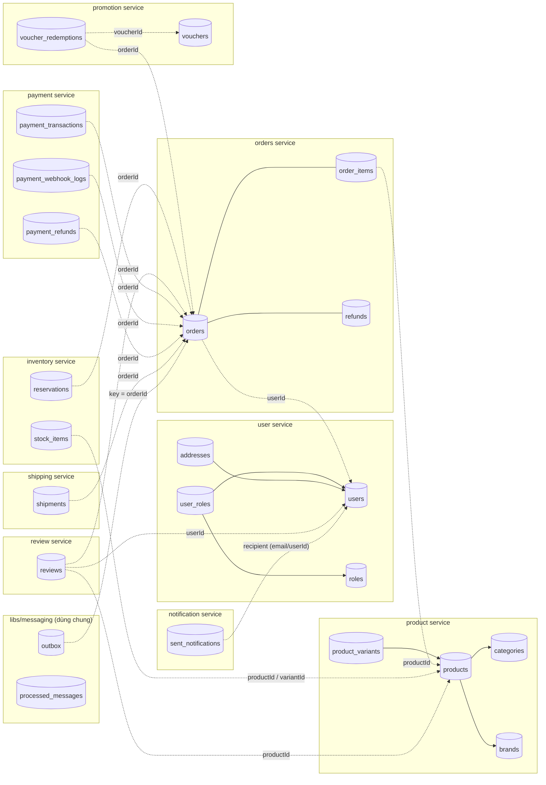
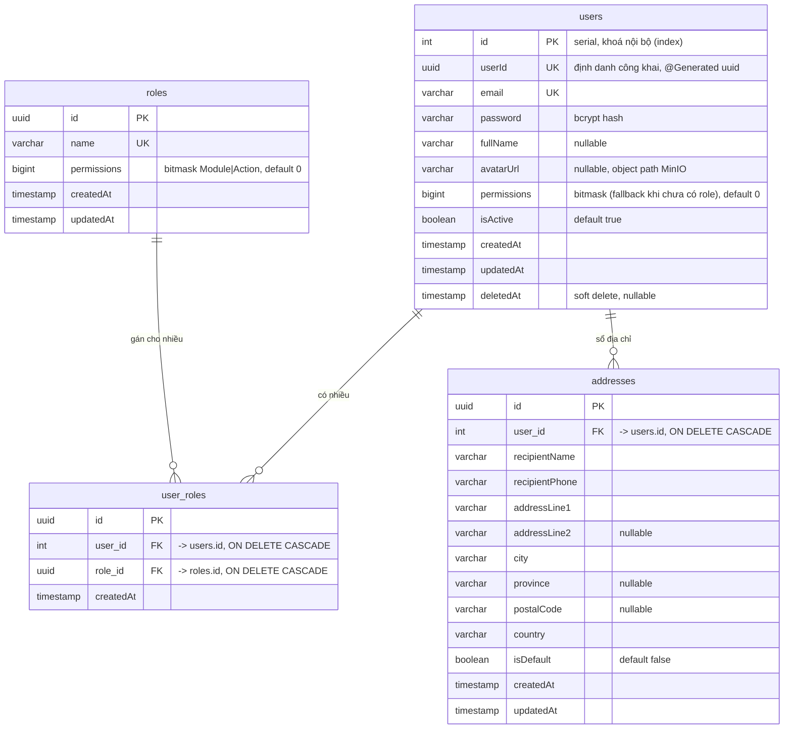
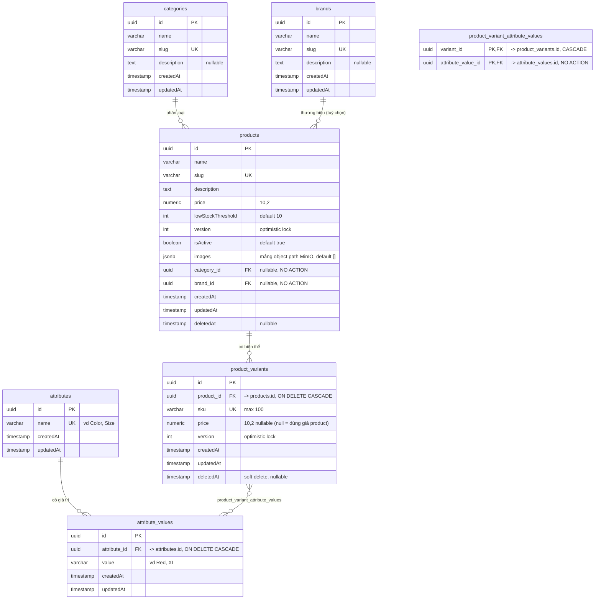
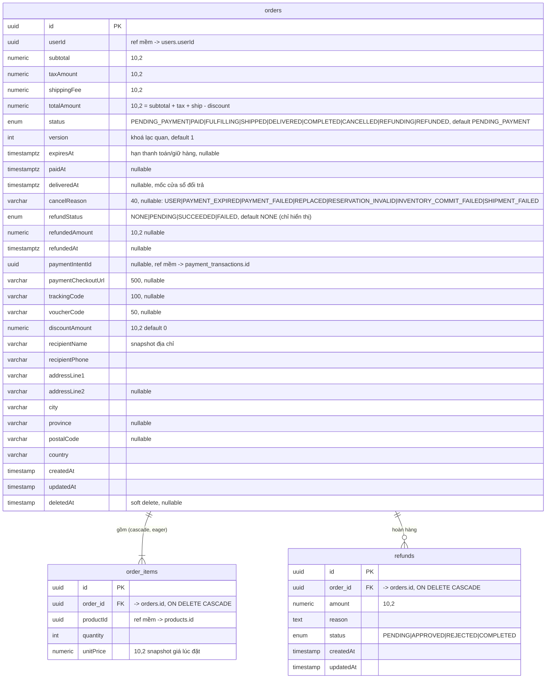
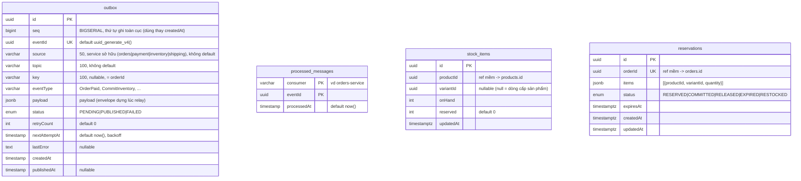

# Database Schema — Relational Diagram (Mermaid)

**Ngày cập nhật**: 2026-10-15
**Nguồn**: entity TypeORM trong `apps/*/src/entities/` đối chiếu migration `libs/database/src/migrations/`. DB: PostgreSQL 15, database `ecommerce`, `synchronize:false`, migration chạy khi service khởi động.
> **Trạng thái kiểm chứng** (2026-10-15): schema dưới đây theo entity/migration sau cutover checkout v2. Bảy migration checkout v2 (`1791874600000` … `1791879000000`) đã chạy trên DB test `ecommerce_test` (up/down/up, remap dữ liệu đúng) và trên DB dev `ecommerce` (đã backup trước). Int-spec các bảng mới pass trên Postgres thật. Chi tiết: [integration-test-report.md](../plans/261015-1700-checkout-v2-event-driven/reports/integration-test-report.md).

> **Ghi chú đọc sơ đồ**
> - Toàn bộ service dùng **chung 1 database**, nhưng mỗi bảng thuộc về **1 service sở hữu** (mục 1). Quan hệ giữa các service là **tham chiếu mềm bằng UUID** (không có FOREIGN KEY) — vẽ bằng nét đứt (`..`) ở sơ đồ tổng thể.
> - Đường nét liền (`--`) = FK thật trong DB.
> - Tên cột giữ nguyên camelCase như trong DB (`"createdAt"`), riêng cột FK dùng snake_case (`user_id`, `order_id`…).
> - Các bảng `users`, `products`, `orders`, `order_items`, `categories` được tạo từ giai đoạn đầu (synchronize); các migration sau chỉ `ALTER` thêm cột — cột/kiểu dưới đây là trạng thái **hiện tại theo entity**.

---

## 1. Bảng thuộc service nào

| Service | Bảng |
|---|---|
| user | `users`, `roles`, `user_roles`, `addresses` |
| product | `categories`, `brands`, `products`, `attributes`, `attribute_values`, `product_variants`, `product_variant_attribute_values` (chỉ catalog, không có cột tồn kho) |
| inventory | `stock_items`, `reservations` (+ dùng chung `outbox`, `processed_messages`) |
| orders | `orders`, `order_items`, `refunds` (+ dùng chung `outbox`, `processed_messages`) |
| payment | `payment_transactions` (payment intent), `payment_webhook_logs`, `payment_refunds` (+ `outbox`, `processed_messages`) |
| shipping | `shipments` (+ `outbox`, `processed_messages`) |
| notification | `sent_notifications` (+ `processed_messages`) |
| review | `reviews` |
| promotion | `vouchers`, `voucher_redemptions` (+ `processed_messages`) |
| `libs/messaging` (dùng chung) | `outbox` (mỗi service chỉ relay row có `source` của mình), `processed_messages` (Inbox, khoá `(consumer, eventId)`) |
| (Redis, không phải SQL) | `cart:{userId}`, `refresh_token:{userId}:{sessionId}`, `idempotency:{key}`, throttle counters |

---

## 2. Sơ đồ tổng thể theo service (cross-service = tham chiếu mềm)

> Voucher nối checkout qua `voucher_redemptions` (theo `orderId`) và `orders.voucherCode/discountAmount`.
> `product_variants` **không** được tham chiếu bởi `order_items` (đơn hàng tham chiếu `productId`, chưa có `variantId`; `stock_items.variantId` đã có cho tương lai).

---

## 3. ERD chi tiết — User service

**Ràng buộc/quy tắc**
- `user_roles`: `UNIQUE(user_id, role_id)`.
- Quyền hiệu lực = `OR` mọi `roles.permissions` của user; nếu user không có role nào thì dùng `users.permissions`.
- `users.id` (serial) chỉ dùng cho FK nội bộ; **các service khác dùng `users.userId` (uuid)**. Chú ý: `orders.userId`, `reviews.userId` trỏ tới `users."userId"`, không phải `users.id`.
- "Mỗi user chỉ 1 địa chỉ default" được đảm bảo **bằng code** (transaction bỏ default cũ), không có ràng buộc DB.

---

## 4. ERD chi tiết — Product service

**Ràng buộc/quy tắc**
- Bảng nối `product_variant_attribute_values`: PK ghép `(variant_id, attribute_value_id)`, có index trên từng cột.
- `products.category_id` bắt buộc ở tầng code (404 nếu không tồn tại) nhưng cột DB **nullable**.
- Product/Variant **không còn cột `stock`** (migration `FinalizeOrderStatusAndStockOwnership` đã bỏ, sau khi bù dòng còn thiếu vào `stock_items`); tồn kho nằm ở `stock_items` (mục 5a). `@VersionColumn` vẫn có nhưng không còn phục vụ trừ kho.
- Xoá product (cascade xuống variants ở DB, nhưng code dùng `remove` hard delete cho product và `softRemove` cho variant). Xoá `attribute_value` đang được variant dùng bị chặn (NO ACTION).
- Không có ràng buộc "mỗi variant chỉ 1 value cho mỗi attribute" — kiểm soát bằng code (hiện chưa kiểm tra).

---

## 5. ERD chi tiết — Orders service

**Ràng buộc/quy tắc**
- Index: `IDX_orders_status_expires (status, expiresAt)` (scheduler hết hạn), `IDX_orders_status_delivered (status, deliveredAt)` (auto COMPLETED), `IDX_orders_user_status (userId, status)` (tìm đơn `replaces`).
- Chuyển trạng thái hợp lệ (kiểm tra bằng code, không có CHECK): PENDING_PAYMENT→{PAID,CANCELLED}, PAID→{FULFILLING,CANCELLED}, FULFILLING→{SHIPPED,CANCELLED}, SHIPPED→DELIVERED, DELIVERED→{REFUNDING,COMPLETED}, REFUNDING→REFUNDED. Mọi đổi trạng thái dùng `UPDATE ... WHERE version` + ghi `outbox` cùng transaction.
- `refunds` chỉ còn dùng cho **hoàn hàng sau giao** (`PENDING` khi `REFUNDING`, `COMPLETED` khi `REFUNDED`); `APPROVED`/`REJECTED` còn trong enum nhưng không còn code ghi. Hoàn tiền khi huỷ theo dõi bằng `orders.refundStatus` + `payment_refunds`.
- Giỏ hàng **không có bảng** — nằm ở Redis (`cart:{userId}`: `{items:[{productId,quantity}]}`).

### 5a. Outbox / Inbox dùng chung (`libs/messaging`) và Inventory

- `outbox`: index `IDX_outbox_relay (status, source, seq)`, `IDX_outbox_key_status (key, status)`, `UQ_outbox_eventId`. Relay: `FOR UPDATE OF o SKIP LOCKED`, giữ thứ tự theo `key`. `source`/`topic` **không còn default** (OutboxWriter luôn điền).
- `processed_messages`: PK `(consumer, eventId)`; `INSERT ... ON CONFLICT DO NOTHING` + kiểm số dòng để khử trùng.
- `stock_items`: unique `(productId, variantId) NULLS NOT DISTINCT` (`UQ_stock_items_product_variant`, PG15); CHECK `CHK_stock_items_reserved (reserved >= 0 AND onHand >= reserved)`. `available = onHand - reserved`; thiếu dòng = 0.
- `reservations`: `UQ_reservations_orderId`, `IDX_reservations_status_expiresAt` (job hết hạn).

---

## 6. ERD chi tiết — Payment, Shipping, Notification, Review, Promotion

```mermaid
erDiagram
  payment_transactions {
    uuid id PK "= intentId"
    uuid orderId "ref mềm -> orders.id (index)"
    varchar idempotencyKey UK "Orders dùng orderId làm key"
    numeric amount "10,2"
    enum status "PENDING|SUCCEEDED|FAILED|CANCELLED"
    varchar failureReason "nullable"
    timestamptz expiresAt "nullable, = hạn giữ hàng"
    varchar checkoutUrl "500, nullable"
    timestamptz paidAt "nullable"
    timestamp createdAt
    timestamptz updatedAt
  }
  payment_webhook_logs {
    uuid id PK
    varchar eventId UK "khử trùng webhook"
    uuid orderId "ref mềm -> orders.id"
    timestamp processedAt
  }
  payment_refunds {
    uuid id PK
    uuid orderId UK "mỗi đơn hoàn tối đa 1 lần"
    uuid transactionId "nullable"
    numeric amount "10,2, nhận tường minh (total - ship)"
    enum status "PENDING|SUCCEEDED|FAILED (thực tế chỉ ghi trạng thái cuối)"
    varchar reason "nullable"
    varchar failureReason "nullable"
    timestamptz createdAt
    timestamptz updatedAt
  }
  shipments {
    uuid id PK
    uuid orderId UK "ref mềm -> orders.id"
    enum status "CREATED|DELIVERED|CANCELLED|FAILED"
    varchar trackingCode "100, nullable"
    varchar carrier "50, nullable"
    varchar failureReason "500, nullable"
    timestamptz deliveredAt "nullable"
    timestamptz createdAt
    timestamptz updatedAt
  }
  sent_notifications {
    uuid id PK
    enum channel "EMAIL|PUSH"
    varchar recipient "email, fallback userId"
    varchar subject
    text body
    enum status "SENT|FAILED"
    varchar sourceEvent "nullable, vd OrderCreated"
    timestamp createdAt
  }
  reviews {
    uuid id PK
    uuid userId "ref mềm -> users.userId"
    uuid productId "ref mềm -> products.id"
    uuid orderId "ref mềm -> orders.id"
    int rating "1..5 (validate ở DTO)"
    text comment "nullable"
    timestamp createdAt
  }
  vouchers {
    uuid id PK
    varchar code UK "max 50, phân biệt hoa thường"
    enum discountType "PERCENTAGE|FIXED"
    numeric discountValue "10,2"
    numeric minOrderValue "10,2 default 0"
    timestamp expiresAt
    int usageLimit
    int usageCount "default 0"
    timestamp createdAt
  }
  voucher_redemptions {
    uuid id PK
    uuid voucherId "ref mềm -> vouchers.id (index)"
    varchar code "50"
    uuid orderId UK "ref mềm -> orders.id"
    uuid userId
    numeric discountAmount "10,2"
    enum status "RESERVED|CONFIRMED|RELEASED, default RESERVED"
    timestamptz createdAt
    timestamptz updatedAt
  }
```

**Ràng buộc/quy tắc**
- `reviews`: `UNIQUE(userId, productId, orderId)` — mỗi (user, sản phẩm, đơn) chỉ review một lần. `rating` chỉ được kiểm tra ở DTO (`@Min(1) @Max(5)`), không có CHECK trong DB.
- `payment_transactions` là **payment intent** (một đơn một dòng nhờ `idempotencyKey = orderId`); `payment_refunds.orderId` unique → hoàn cả đơn đúng một lần, `FAILED` không retry được.
- `vouchers.usageCount` được cập nhật dưới `SELECT … FOR UPDATE` (pessimistic lock); `voucher_redemptions.orderId` unique làm reserve idempotent theo đơn; redemption `CONFIRMED` không bao giờ bị trả lượt.
- `shipments.orderId` unique: mỗi đơn tối đa một vận đơn.
- Nhóm bảng này không có FK nào ra ngoài (xem sơ đồ tổng thể mục 2 cho các tham chiếu mềm).

---

## 7. Index & ràng buộc duy nhất (tổng hợp)

| Bảng | Unique / Index |
|---|---|
| users | `email` (UK), `id` (index), `userId` (không unique ở DB — chỉ `@Generated`) |
| roles | `name` (UK) |
| user_roles | `(user_id, role_id)` (UK) |
| categories / brands | `slug` (UK) |
| products | `slug` (UK) — index `createdAt` đã bị migration InitSchema xoá |
| product_variants | `sku` (UK) |
| attributes | `name` (UK) |
| product_variant_attribute_values | PK `(variant_id, attribute_value_id)`, index từng cột |
| orders | `IDX_orders_status_expires`, `IDX_orders_status_delivered`, `IDX_orders_user_status` |
| outbox | `UQ_outbox_eventId`, `IDX_outbox_relay (status, source, seq)`, `IDX_outbox_key_status (key, status)` |
| processed_messages | PK `(consumer, eventId)` |
| stock_items | `UQ_stock_items_product_variant (productId, variantId) NULLS NOT DISTINCT` + CHECK `reserved >= 0 AND onHand >= reserved` |
| reservations | `UQ_reservations_orderId`, `IDX_reservations_status_expiresAt` |
| payment_transactions | `idempotencyKey` (UK), `IDX_payment_transactions_orderId` |
| payment_refunds | `orderId` (UK) |
| shipments | `UQ_shipments_orderId` |
| voucher_redemptions | `UQ_voucher_redemptions_orderId`, `IDX_voucher_redemptions_voucherId` |
| payment_webhook_logs | `eventId` (UK) |
| reviews | `(userId, productId, orderId)` (UK) |
| vouchers | `code` (UK) |

**Thiếu index đáng chú ý** (đề xuất, chưa có trong code): `order_items(order_id)`, `refunds(order_id)`, `reviews(productId)`, `sent_notifications(recipient)`, trigram index cho `products.name` (tìm kiếm `ILIKE '%q%'`).

> Lưu ý: `users.userId` được các service khác dùng làm khoá tham chiếu nhưng **chưa có ràng buộc UNIQUE** ở DB (chỉ cột `uuid` sinh tự động). Nên thêm unique index.

---

## 8. Quy ước & khác biệt cần biết

- **Kiểu tiền**: `numeric(10,2)` (TypeORM trả string; code ép `Number()`). Trần ~99.999.999,99 — có thể không đủ cho VND giá trị lớn.
- **Enum PostgreSQL**: `orders_status_enum` (9 trạng thái; migration chốt tạo lại enum, đổi cột sang `text` rồi ép về enum mới vì Postgres cấm dùng giá trị vừa `ADD VALUE` trong cùng transaction), `orders_refundstatus_enum`, `refunds_status_enum`, `outbox_status_enum`, `payment_transactions_status_enum`, `payment_refunds_status_enum`, `shipments_status_enum`, `reservations_status_enum`, `voucher_redemptions_status_enum`, `sent_notifications_channel_enum`, `sent_notifications_status_enum`, `vouchers_discounttype_enum`.
- **Migration của luồng checkout v2** (thứ tự áp, mọi cái idempotent, có `down`): `1791874600000-AddKafkaOutboxAndInbox`, `1791874800000-AddOrderLifecycleColumns`, `1791875000000-AddInventoryTables`, `1791876000000-AddPaymentIntentAndRefund`, `1791877000000-AddShipments`, `1791878000000-AddVoucherRedemptions`, `1791879000000-FinalizeOrderStatusAndStockOwnership` (đơn `PENDING/PROCESSING` → `PENDING_PAYMENT` + `expiresAt = now()`; `DELIVERED` thiếu `deliveredAt` → `updatedAt`; bỏ cột `stock`; bỏ default `outbox.topic/source`).
- **Cảnh báo phá huỷ**: `FinalizeOrderStatusAndStockOwnership` xoá cột `stock` của `products` và `product_variants` (sau khi bù dòng còn thiếu vào `stock_items`) và đổi enum `orders.status`. `down` không khôi phục trạng thái đơn đã chuyển. Service chạy `migrationsRun:true`, nên migration chạy ngay khi service khởi động: **backup DB trước** khi bật service trên dữ liệu có sẵn.
- **Soft delete (`deletedAt`)**: `users`, `products`, `orders`, `product_variants`. Thực tế chỉ variant dùng `softRemove`; product bị `remove` (xoá cứng).
- **Khoá chính**: `uuid` (`uuid_generate_v4()`), ngoại lệ `users.id` (serial) và bảng nối (PK ghép).
- **Không database-per-service**: muốn tách DB về sau, mọi liên kết giữa các cụm ở mục 2 đã là tham chiếu mềm nên chỉ cần chuyển bảng theo cụm.
- Dữ liệu seed (`npm run seed`) ghi thẳng bằng `pg` vào các bảng trên (~50.000 products kèm `stock_items`, 20.000 orders phân bố theo state machine mới, 2.000 users). Seed chưa được chạy lại sau cutover.

---

## 9. Tài liệu liên quan
- [module-processing-flows.md](./module-processing-flows.md) — cách từng service đọc/ghi các bảng này
- [business-flows.md](./business-flows.md) — rule nghiệp vụ trên dữ liệu (state machine đơn, refund, voucher)
- [target-checkout-architecture.md](./target-checkout-architecture.md) — thiết kế checkout v2 và trạng thái triển khai
- [design-trade-offs.md](./design-trade-offs.md) — vì sao tham chiếu mềm, một DB chung, kiểu tiền
- [onboarding-guide.md](./onboarding-guide.md)
