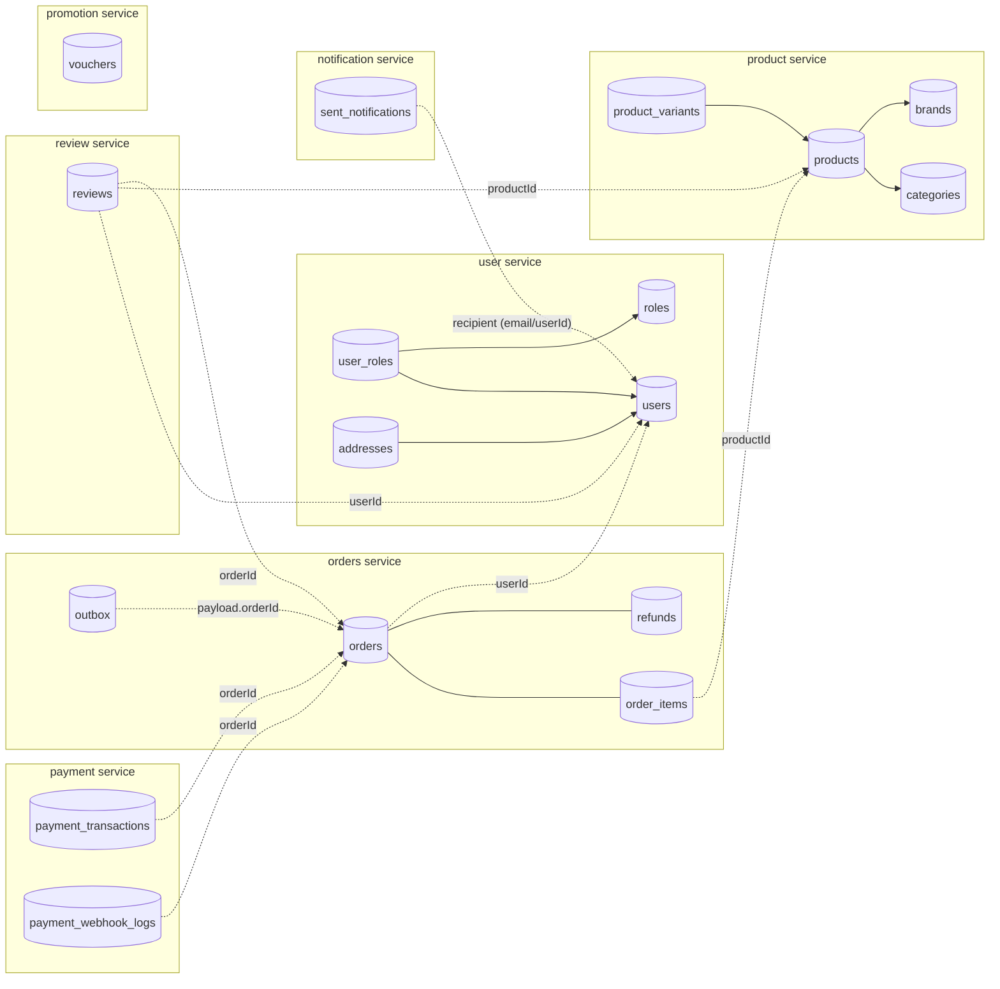
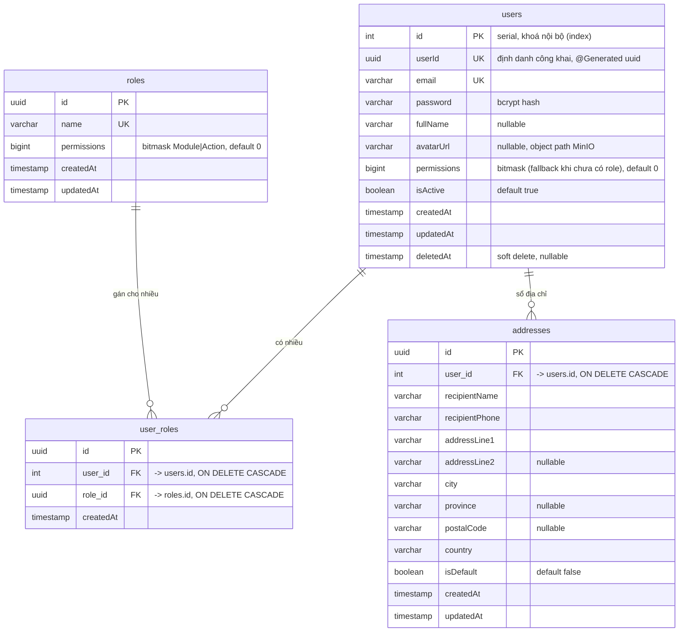
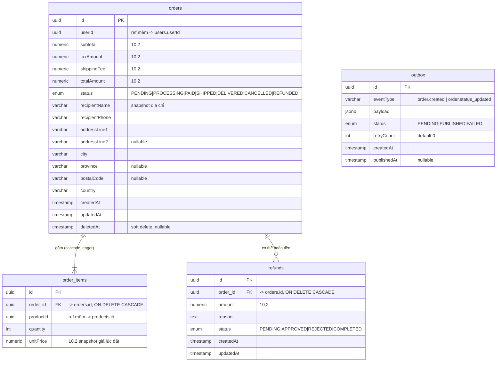
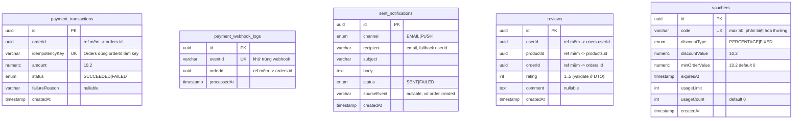

# Database Schema — Relational Diagram (Mermaid)

**Ngày cập nhật**: 2026-10-05
**Nguồn**: entity TypeORM trong `apps/*/src/entities/` đối chiếu migration `libs/database/src/migrations/`. DB: PostgreSQL 15, database `ecommerce`, `synchronize:false`, migration chạy khi service khởi động.

> **Ghi chú đọc sơ đồ**
> - Toàn bộ service dùng **chung 1 database**, nhưng mỗi bảng thuộc về **1 service sở hữu** (mục 1). Quan hệ giữa các service là **tham chiếu mềm bằng UUID** (không có FOREIGN KEY) — vẽ bằng nét đứt (`..`) ở sơ đồ tổng thể.
> - Đường nét liền (`--`) = FK thật trong DB.
> - Tên cột giữ nguyên camelCase như trong DB (`"createdAt"`), riêng cột FK dùng snake_case (`user_id`, `order_id`…).
> - Các bảng `users`, `products`, `orders`, `order_items`, `categories` được tạo từ giai đoạn đầu (synchronize); các migration sau chỉ `ALTER` thêm cột — cột/kiểu dưới đây là trạng thái **hiện tại theo entity**.

---

## 1. Bảng thuộc service nào

| Service | Bảng |
|---|---|
| user | `users`, `roles`, `user_roles`, `addresses` |
| product | `categories`, `brands`, `products`, `attributes`, `attribute_values`, `product_variants`, `product_variant_attribute_values` |
| orders | `orders`, `order_items`, `refunds`, `outbox` |
| payment | `payment_transactions`, `payment_webhook_logs` |
| notification | `sent_notifications` |
| review | `reviews` |
| promotion | `vouchers` |
| (Redis, không phải SQL) | `cart:{userId}`, `refresh_token:{userId}:{sessionId}`, `idempotency:{key}`, throttle counters |

---

## 2. Sơ đồ tổng thể theo service (cross-service = tham chiếu mềm)

> `vouchers` hiện **không** liên kết với bảng nào (voucher chưa nối vào checkout; `orders` không có cột voucher/discount).
> `product_variants` **không** được tham chiếu bởi `order_items` (đơn hàng tham chiếu `productId`, chưa có `variantId`).

---

## 3. ERD chi tiết — User service

**Ràng buộc/quy tắc**
- `user_roles`: `UNIQUE(user_id, role_id)`.
- Quyền hiệu lực = `OR` mọi `roles.permissions` của user; nếu user không có role nào thì dùng `users.permissions`.
- `users.id` (serial) chỉ dùng cho FK nội bộ; **các service khác dùng `users.userId` (uuid)**. Chú ý: `orders.userId`, `reviews.userId` trỏ tới `users."userId"`, không phải `users.id`.
- "Mỗi user chỉ 1 địa chỉ default" được đảm bảo **bằng code** (transaction bỏ default cũ), không có ràng buộc DB.

---

## 4. ERD chi tiết — Product service

**Ràng buộc/quy tắc**
- Bảng nối `product_variant_attribute_values`: PK ghép `(variant_id, attribute_value_id)`, có index trên từng cột.
- `products.category_id` bắt buộc ở tầng code (404 nếu không tồn tại) nhưng cột DB **nullable**.
- `products.stock` và `product_variants.stock` là **hai kho độc lập**; trừ kho dùng `@VersionColumn` (retry 1 lần khi lệch version).
- Xoá product (cascade xuống variants ở DB, nhưng code dùng `remove` hard delete cho product và `softRemove` cho variant). Xoá `attribute_value` đang được variant dùng bị chặn (NO ACTION).
- Không có ràng buộc "mỗi variant chỉ 1 value cho mỗi attribute" — kiểm soát bằng code (hiện chưa kiểm tra).

---

## 5. ERD chi tiết — Orders service

**Ràng buộc/quy tắc**
- `outbox` **không có FK** tới `orders`; liên hệ nằm trong `payload.orderId`. Được ghi cùng transaction với thay đổi trạng thái đơn.
- Tổng tiền: `totalAmount = subtotal + taxAmount + shippingFee`; không có cột voucher/discount/paymentTransactionId.
- Chuyển trạng thái hợp lệ: PENDING→{PROCESSING,CANCELLED}, PROCESSING→{PAID,CANCELLED}, PAID→{SHIPPED,CANCELLED}, SHIPPED→DELIVERED, DELIVERED→REFUNDED (kiểm tra bằng code, không có CHECK constraint).
- `refunds.status = APPROVED` có trong enum nhưng code đi thẳng `PENDING → COMPLETED`. Tổng refund không bị REJECTED ≤ `orders.totalAmount` (kiểm tra bằng code, không lock).
- Giỏ hàng **không có bảng** — nằm ở Redis (`cart:{userId}`: `{items:[{productId,quantity}]}`).

---

## 6. ERD chi tiết — Payment, Notification, Review, Promotion

**Ràng buộc/quy tắc**
- `reviews`: `UNIQUE(userId, productId, orderId)` — mỗi (user, sản phẩm, đơn) chỉ review một lần. `rating` chỉ được kiểm tra ở DTO (`@Min(1) @Max(5)`), không có CHECK trong DB.
- `payment_transactions.idempotencyKey` unique chống lưu trùng, nhưng không chặn việc gọi provider hai lần trong cuộc đua (xem [design-trade-offs.md](./design-trade-offs.md)).
- `vouchers.usageCount` được cập nhật dưới `SELECT … FOR UPDATE` (pessimistic lock).
- Nhóm bảng này không có FK nào ra ngoài (xem sơ đồ tổng thể mục 2 cho các tham chiếu mềm).

---

## 7. Index & ràng buộc duy nhất (tổng hợp)

| Bảng | Unique / Index |
|---|---|
| users | `email` (UK), `id` (index), `userId` (không unique ở DB — chỉ `@Generated`) |
| roles | `name` (UK) |
| user_roles | `(user_id, role_id)` (UK) |
| categories / brands | `slug` (UK) |
| products | `slug` (UK) — index `createdAt` đã bị migration InitSchema xoá |
| product_variants | `sku` (UK) |
| attributes | `name` (UK) |
| product_variant_attribute_values | PK `(variant_id, attribute_value_id)`, index từng cột |
| payment_transactions | `idempotencyKey` (UK) |
| payment_webhook_logs | `eventId` (UK) |
| reviews | `(userId, productId, orderId)` (UK) |
| vouchers | `code` (UK) |

**Thiếu index đáng chú ý** (đề xuất, chưa có trong code): `orders(userId)`, `order_items(order_id)`, `refunds(order_id)`, `outbox(status, createdAt)`, `reviews(productId)`, `payment_transactions(orderId)`, `sent_notifications(recipient)`, trigram index cho `products.name` (tìm kiếm `ILIKE '%q%'`).

> Lưu ý: `users.userId` được các service khác dùng làm khoá tham chiếu nhưng **chưa có ràng buộc UNIQUE** ở DB (chỉ cột `uuid` sinh tự động). Nên thêm unique index.

---

## 8. Quy ước & khác biệt cần biết

- **Kiểu tiền**: `numeric(10,2)` (TypeORM trả string; code ép `Number()`). Trần ~99.999.999,99 — có thể không đủ cho VND giá trị lớn.
- **Enum PostgreSQL**: `orders_status_enum`, `refunds_status_enum`, `outbox_status_enum`, `payment_transactions_status_enum`, `sent_notifications_channel_enum`, `sent_notifications_status_enum`, `vouchers_discounttype_enum`.
- **Soft delete (`deletedAt`)**: `users`, `products`, `orders`, `product_variants`. Thực tế chỉ variant dùng `softRemove`; product bị `remove` (xoá cứng).
- **Khoá chính**: `uuid` (`uuid_generate_v4()`), ngoại lệ `users.id` (serial) và bảng nối (PK ghép).
- **Không database-per-service**: muốn tách DB về sau, mọi liên kết giữa các cụm ở mục 2 đã là tham chiếu mềm nên chỉ cần chuyển bảng theo cụm.
- Dữ liệu seed (`npm run seed`) ghi thẳng bằng `pg` vào các bảng trên (~50.000 products, 20.000 orders, 2.000 users).

---

## 9. Tài liệu liên quan
- [module-processing-flows.md](./module-processing-flows.md) — cách từng service đọc/ghi các bảng này
- [business-flows.md](./business-flows.md) — rule nghiệp vụ trên dữ liệu (state machine đơn, refund, voucher)
- [design-trade-offs.md](./design-trade-offs.md) — vì sao tham chiếu mềm, một DB chung, kiểu tiền
- [onboarding-guide.md](./onboarding-guide.md)
